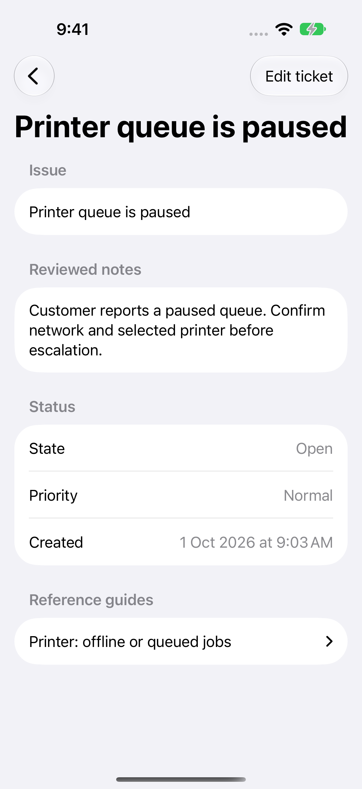

# Service Desk Assistant

A native iPhone, iPad, and Mac workspace for finding troubleshooting guides, preparing suggestions with Apple's on-device model, and reviewing local support tickets.

[](https://github.com/DawoodAamir/Service-Desk-Assistant/actions/workflows/ci.yml)



## Workflows

- Add your own local knowledge guides or load an explicitly labelled sample set.
- Describe an issue and inspect matching guides. Retrieval uses transparent token overlap, with title weighting and deterministic ordering.
- Ask for reversible next steps or a structured-in-text ticket draft. Streamed suggestions can be cancelled; changing the issue invalidates them.
- Attach a bounded, re-encoded issue photo for models that support vision. Images are optional and temporary.
- Review and edit the ticket's title, issue, notes, priority, and status before saving. Case history and source guide references persist across launches.
- Use guide search and manual tickets when Apple Intelligence is unavailable.

Nothing is automatically sent to a customer or external ticketing system. Retrieved guides are inspectable source material, not a guarantee that every generated sentence is supported. The app has no account, backend, ticket-provider integration, or vendor-certified troubleshooting database.

## Run

Open **Service Desk Assistant.xcodeproj** in Xcode 27. Run on an iPhone/iPad with iOS/iPadOS 27 or a Mac with macOS 27. Bundle ID: `com.dd.servicedeskassistant`. No personal signing team, credentials, third-party packages, or App Store identity is included.

Start in Knowledge guides and choose Load sample guides. Return to New case and describe a paused printer queue. Inspect the guide, request a suggestion if the model is ready, then choose Review ticket. Edit the notes and save; reopen the case from the sidebar.

Assistance uses **SystemLanguageModel** on-device. Eligibility, model readiness, language support, and Apple Intelligence settings govern availability. Photo input additionally requires the model's vision capability. There is no cloud fallback. The app reports unavailable states and preserves its manual workflow.

## Native design and engineering

The layout follows [Apple's Human Interface Guidelines](https://developer.apple.com/design/): native split navigation, collapsed iPhone navigation, disclosure groups, standard forms, semantic labels, system typography, and restrained colour. Ticket review is a separate editable form, and saving is an explicit action.

Swift 6 strict concurrency is enabled. An actor owns atomic local persistence and revision-checked updates. Observable UI and streamed results stay on the main actor. Each request uses a fresh OS 27 model profile for its task; cancellation tokens reject stale output. Guide excerpts bound model context around relevant text. Photos are limited to 20 MB/50 megapixels and decoded to 1600 pixels before use.

- `Sources/Core`: guide matching, bounded excerpts, case records, actor persistence.
- `Sources/App`: native views, dynamic model profiles, prompt construction, image import.
- `Tests/Core`: original retrieval fixtures, persistence/conflict regressions, corrupt-store preservation.
- `Tests/UI`: load guides, review a ticket, edit notes, save, relaunch, and inspect the case.
- `Tests/Evaluations`: Apple's test-only Evaluations framework with original model-draft fixtures.
- `Scripts/GenerateIcon.swift`: reproducible original headset artwork for both platforms.

Guides support 200-character titles and 12,000-character bodies; issues are bounded to 4,000 characters and saved notes to 8,000. No guide deletion or external syncing is implemented. The JSON library is versioned; unreadable data is preserved rather than reset.

## Verification

```sh
swift test
swift test -c release
bash Scripts/test-ui.sh
# Optional: ready on-device model on this Mac
bash Scripts/test-model.sh
xcodebuild -project 'Service Desk Assistant.xcodeproj' -scheme 'Model Evaluations' -destination 'platform=macOS' test
```

The native workflow and core tests pass locally. The standalone production-profile model check also passed all three original fixtures on this Mac. CI builds Release apps for Mac and iOS Simulator, runs storage/retrieval tests, compiles the evaluation suite, and retains workflow attachments. See [verification notes](Docs/Verification.md) for actual coverage.

Model evaluations are **opt-in**. In the Model Evaluations scheme, add `DESK_MODEL_EVALUATIONS=1` to the test environment on a Mac with a ready on-device model. The dataset includes ordinary support cases and an instruction-injection attempt. Metrics check bounded draft length and selected false-completion phrases; they are starter quality signals, not a safety certification or proof of grounding. Transcripts are not recorded. Extend the fixtures and perform human review before relying on suggestions in a customer workflow.

## Data and contribution

Cases and guides remain in the app's local sandbox. There is no telemetry or application-operated network service. Read [PRIVACY.md](PRIVACY.md), [CONTRIBUTING.md](CONTRIBUTING.md), and the [MIT license](LICENSE).

Apple references: [Foundation Models](https://developer.apple.com/documentation/foundationmodels), [OS 27 model updates](https://developer.apple.com/videos/play/wwdc2026/241/), [Evaluations](https://developer.apple.com/videos/play/wwdc2026/298/).
